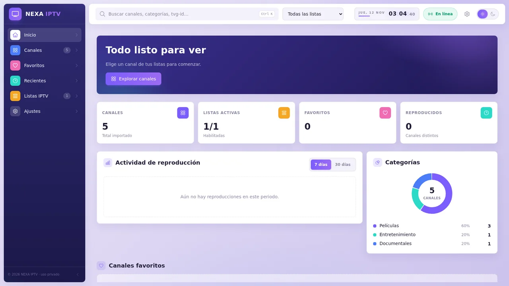
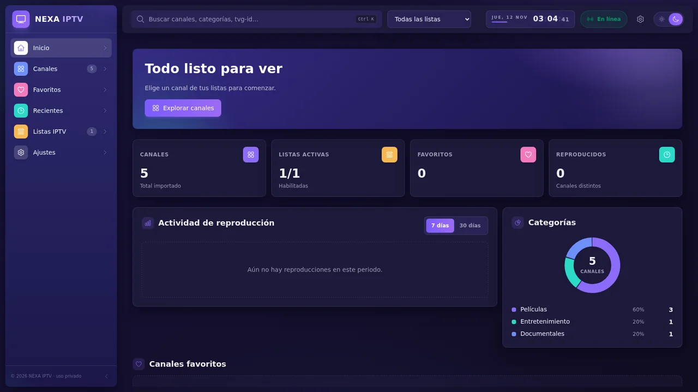
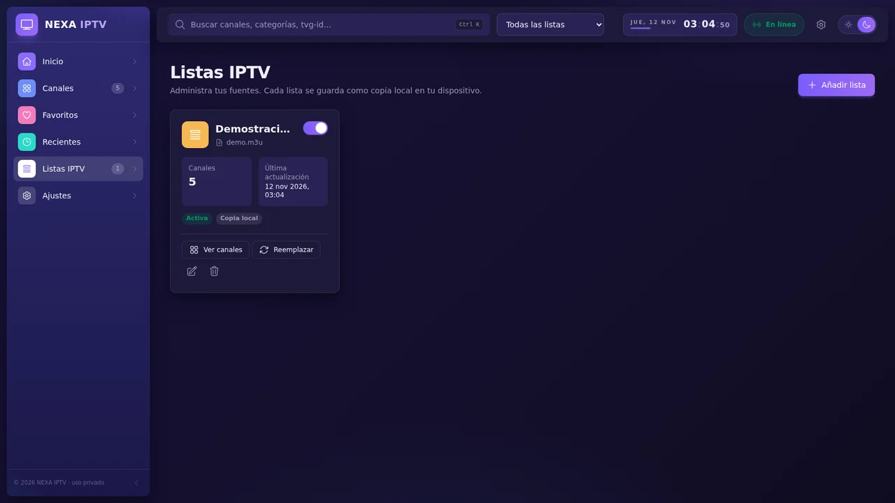
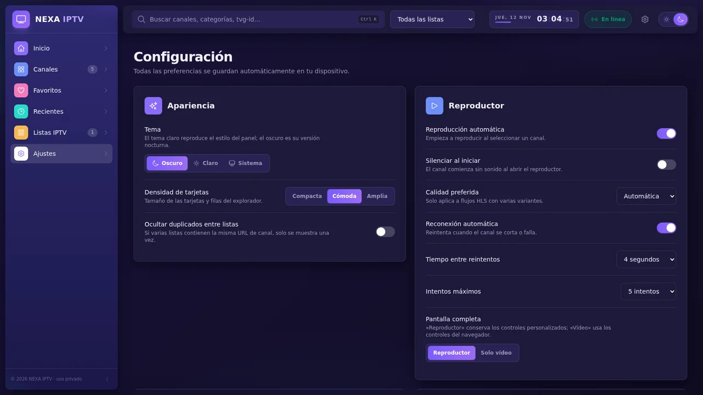
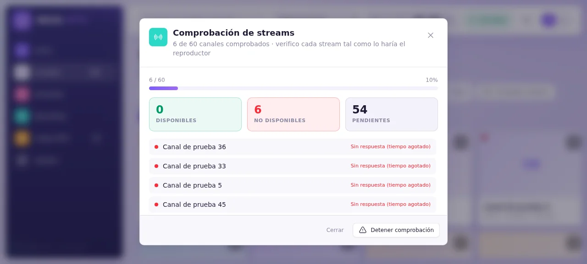
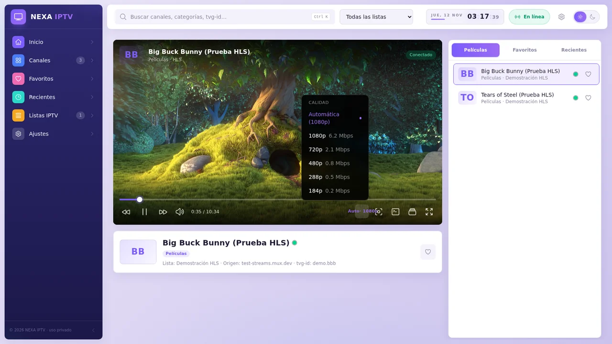

<div align="center">


**Reproductor de listas M3U/M3U8 que corre íntegramente en tu navegador.**
Importa, organiza y reproduce tus propias listas con persistencia local en IndexedDB — sin cuentas, sin servidores, sin telemetría.

[](https://react.dev/)
[](https://www.typescriptlang.org/)
[](https://vite.dev/)
[](https://tailwindcss.com/)
[](https://vitest.dev/)
[](#compilación-en-un-solo-archivo)

</div>

---

> [!IMPORTANT]
> NEXA IPTV **no incluye ni proporciona canales**. Es un reproductor para listas que tú aportas: usa únicamente fuentes que tengas autorización para reproducir. No hay registro, telemetría ni servidores propios; ninguna lista sale de tu navegador.

## Índice

1. [Capturas](#capturas)
2. [Características](#características)
3. [Puesta en marcha](#puesta-en-marcha)
4. [Compilación en un solo archivo](#compilación-en-un-solo-archivo)
5. [Stack técnico](#stack-técnico)
6. [Arquitectura](#arquitectura)
7. [Privacidad y seguridad](#privacidad-y-seguridad)
8. [Limitaciones conocidas](#limitaciones-conocidas)
9. [Pruebas automatizadas](#pruebas-automatizadas)

## Capturas

| Inicio · tema claro | Inicio · tema oscuro |
|---|---|
|  |  |

| Listas · a viewport completo | Ajustes · a viewport completo |
|---|---|
|  |  |

| Comprobador de disponibilidad | Selector de calidad |
|---|---|
|  |  |

## Características

| Área | Qué incluye |
|---|---|
| **Listas** | Añadir por URL (varias a la vez, una por línea) · importar uno o varios archivos con arrastrar y soltar · nombre personalizado · renombrar · actualizar desde la URL o reemplazar desde archivo · activar/desactivar · eliminar con confirmación · contador de canales y fecha de actualización · barra de progreso y errores por importación |
| **Explorador** | Cuadrícula o lista · búsqueda instantánea por nombre, nombre alternativo, categoría, grupo, tvg-id, idioma y país · filtros por categoría, grupo y lista · orden A–Z · favoritos · indicador de disponibilidad · densidad configurable |
| **Inicio** | Continuar viendo · estadísticas · favoritos · últimos reproducidos · listas · estado de primera ejecución |
| **Reproductor** | hls.js · MPEG-TS/FLV con mpegts.js · reproducción nativa (MP4, WebM, HLS en Safari) · selector de calidad HLS con calidad preferida · aspecto (auto, 16:9, 4:3, llenar, estirar) · PiP · pantalla completa del reproductor o solo del vídeo · volumen y silencio · barra de progreso en contenidos no en directo · indicador EN DIRECTO con «ir a directo» · info y logo del canal · estado de conexión · reconexión automática configurable · watchdog de arranque y de bloqueos · pantalla de error con reintentar/siguiente · controles auto-ocultables · atajos de teclado · cola lateral por categoría, favoritos o recientes |
| **Disponibilidad** | Comprobador que recorre el manifiesto HLS y su primer segmento · concurrencia y tiempo de espera configurables · eliminación de canales caídos tras confirmación en modal propia |
| **Persistencia** | IndexedDB nativo: listas, canales, logos (URL), grupos, favoritos, historial, último canal, ajustes del reproductor y preferencias de interfaz (tema, densidad, vista, barra lateral, lista activa) |
| **Copias de seguridad** | JSON: solo configuración · listas con canales y favoritos · copia completa · restauración fusionando o reemplazando, con validación y saneado campo a campo |
| **Interfaz** | Tema oscuro/claro/sistema · toasts · skeletons · estados vacíos · banner sin conexión · confirmaciones en línea · responsive con barra inferior en móvil y barra lateral contraíble en escritorio · vistas a viewport completo |

## Puesta en marcha

Requisitos: Node.js 18 o superior.

```bash
npm install     # instala dependencias
npm run dev     # desarrollo (http://localhost:5173)
npm run build   # genera dist/index.html
npm run preview # sirve la compilación
npx vitest run  # ejecuta las pruebas automatizadas
```

En Windows hay además scripts de un clic en la raíz del proyecto: `INSTALL.bat`, `START-DEV.bat`, `START.bat`, `BUILD.bat`, `STOP.bat`, `RESTART.bat`, `STATUS.bat` y `DIAGNOSTICS.bat`.

## Compilación en un solo archivo

`npm run build` produce **un único `dist/index.html`** con JS, CSS, hls.js, mpegts.js y el Web Worker del parser incrustados: sin CDNs ni peticiones obligatorias a servicios externos. Se puede servir con cualquier servidor HTTP sencillo:

```bash
npx serve dist
python -m http.server -d dist 8000
```

## Stack técnico

| Tecnología | Papel |
|---|---|
| React 19 + TypeScript | Interfaz con tipos estrictos (`tsc` sin errores) |
| Vite 7 | Desarrollo y compilación con el plugin de archivo único |
| Tailwind CSS 4 | Estilo del tema Aurora (claro/oscuro, violeta) |
| Zustand | Estado global y acciones |
| hls.js | Reproducción HLS en navegadores sin soporte nativo |
| mpegts.js | Reproducción MPEG-TS/FLV sobre Media Source Extensions |
| IndexedDB | Persistencia local (API nativa, sin librerías) |
| Heroicons | Iconografía SVG (outline/solid); sin emojis ni iconos Unicode |
| Vitest + Testing Library | Pruebas en Node y jsdom |

## Arquitectura

```
src/
├── App.tsx                 Shell, tema y enrutado
├── lib/
│   ├── types.ts            Modelos (Channel, Playlist, Settings, BackupFile…)
│   ├── db.ts               Capa IndexedDB (playlists, channels, favorites, history, status, kv)
│   ├── m3u.ts              Parser M3U puro (sin DOM) + saneado
│   ├── m3u.worker.ts       Web Worker que ejecuta el parser fuera del hilo principal
│   ├── parse-async.ts      Puente al worker con fallback al hilo principal
│   ├── categories.ts       Normalización de group-title → categorías
│   ├── availability.ts     Comprobador de disponibilidad HLS (concurrencia, pausa, razones)
│   ├── playlist-manager.ts Importar / actualizar / duplicados / fetch con progreso
│   ├── backup.ts           Exportación, validación/saneado e importación de copias JSON
│   ├── store.ts            Estado global (Zustand) + persistencia + acciones
│   └── router.ts           Router por hash (sin recargas)
├── player/
│   ├── engine.ts           Estrategia por formato: hls.js → MPEG-TS (mpegts.js) → nativo
│   └── Player.tsx          UI del reproductor, reconexión, atajos, PiP, calidad, aspecto
├── components/             Shell (sidebar/header/toasts), tarjetas, virtualización, UI base
└── pages/                  Home, Channels (todos/favoritos), Recents, Playlists, Settings, Watch
tests/                      Vitest: parser, gestor/IndexedDB/backups, disponibilidad, app completa
```

Separación de responsabilidades: **UI** (`components`, `pages`) · **almacenamiento** (`db.ts`) · **listas** (`playlist-manager`, `m3u*`, `backup`) · **reproducción** (`player/`). Todo el estado persistente pasa por `store.ts` → `db.ts`.

<details>
<summary>Decisiones de diseño</summary>

- **Copia local real**: al importar, todos los canales se guardan en IndexedDB; si la URL deja de funcionar, la lista sigue disponible. Si una actualización falla, la copia anterior se conserva intacta y el error se anota en la tarjeta.
- **IDs de canal estables** (`listaId:hash(tvg-id|nombre|grupo)`, sin la URL): al actualizar una lista, favoritos, historial y estado de disponibilidad se conservan aunque cambien tokens o hosts.
- **Duplicados**: entradas con la misma URL dentro de una lista se omiten (y se cuentan); una lista con la misma URL de origen o con los mismos canales que otra se rechaza con aviso; opción para ocultar duplicados entre listas.
- **Categorías**: el `group-title` original se conserva sin tocar; la categoría (Noticias, Deportes, Entretenimiento, Películas, Series, Infantiles, Música, Documentales, Internacionales, Otros) se deriva de él por reglas, y lo que no encaja va a «Otros».
- **Rendimiento**: parser en Web Worker · guardado transaccional · virtualización propia por ventanas (solo se montan las filas visibles) para miles de canales · logos con carga diferida · índice de búsqueda normalizado precalculado · el estado verde/rojo se registra al reproducir o al usar el comprobador, nunca en comprobaciones masivas ocultas.

</details>

## Privacidad y seguridad

- Solo `http(s)` para listas y logos; `javascript:`, `data:` y `file:` se descartan.
- Esquemas permitidos en canales: `http, https, rtmp, rtsp, udp…` (los no reproducibles en navegador se importan y se marcan como «formato no compatible»).
- Descarga de listas con `credentials: omit`, límite de 150 MB y tiempo de espera acotado.
- Los caracteres de control se eliminan y las longitudes se limitan; nada se inserta como HTML (React escapa el contenido).
- Las copias de seguridad se validan y sanean campo a campo antes de restaurarlas.
- Sin telemetría, sin analítica, sin servicios propios: toda la app vive en tu navegador.

## Limitaciones conocidas

- **MPEG-DASH (.mpd)** no está incluido (se informa con un mensaje claro). **RTMP, RTSP, UDP, RTP y SRT** no pueden reproducirse en navegadores: se importan pero se muestra «formato no compatible».
- **CORS**: la descarga de listas por URL y los streams requieren que el servidor permita el acceso desde el navegador; si no, descarga la lista y súbela como archivo. No se incluye ningún mecanismo para eludir restricciones de proveedores (las directivas `#EXTVLCOPT` de user-agent/referer se ignoran).
- **Contenido mixto**: una página servida por HTTPS no puede cargar streams HTTP; para ellos sirve la app por `http://localhost`.
- **Logos**: se guarda su URL con carga diferida y avatar de iniciales si falla, no una copia binaria.
- MPEG-TS depende de Media Source Extensions (no disponible en iOS Safari antiguo).
- No es una PWA instalable y no hay mini-reproductor fuera de la pantalla de reproducción.
- La guía de programación (EPG/XMLTV) no está implementada.

## Pruebas automatizadas

`npx vitest run` · **40 pruebas, 4 archivos, todo verde** · verificación con `tsc` estricto y `npm run build`.

| Área | Cobertura |
|---|---|
| Parser M3U (19) | Atributos completos/ausentes · comas entre comillas · CRLF/BOM · `#EXTGRP` · URLs relativas · duplicados · ids estables · esquemas peligrosos · manifiestos HLS · contenido inválido · **60 000 canales en menos de 1 s** |
| Gestor e IndexedDB (11) | Archivo local · URL (fetch simulado) · URL inválida/`javascript:` · HTTP 404 · fallo CORS/red · archivo vacío o no M3U · duplicados por URL y por contenido · **50 000 canales en IndexedDB** · actualización conservando ids y favoritos con altas/bajas · **conserva la copia local si la URL falla** · borrado en cascada · copias de seguridad (round-trip, rechazo de archivos ajenos, saneado, reemplazo) |
| Disponibilidad (8) | Lista HLS y primer segmento · recorrido master → variante → segmento · 200 que no es HLS · 404 con su motivo · fallo CORS/red · tiempo de espera por canal · detención a mitad · límite de concurrencia |
| App completa (2) | Primera ejecución → lista demo → explorador virtualizado → búsqueda → favoritos → montaje del reproductor → todas las páginas → recarga desde IndexedDB · cambio de tema persistente |

> [!NOTE]
> La interfaz y el flujo completo se verifican con capturas en un navegador real (ver [Capturas](#capturas)). La reproducción con fuentes de vídeo propias no se ha probado en este entorno; la lista de demostración incluye flujos HLS públicos para validar el reproductor con tus propias fuentes (se añade solo si se solicita).

---

<div align="center">

© 2026 NEXA IPTV · uso privado y local

[github.com/novacode-crypto/iptv-player](https://github.com/novacode-crypto/iptv-player)

</div>
